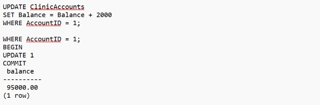

# Portfolio 3: Concurrency Control and Row-Level Locking

**Course:** MIT 8103 – Advanced Database Systems  
**Case Study:** MediCare Health Clinic  
**Database Management System:** PostgreSQL  
**Development Environment:** GitHub Codespaces

## 1. Introduction

Concurrency control matters in databases. Several users might try accessing or changing the same records at the same time. Without it updates can conflict and information ends up inconsistent. 

It seems like that is the main point but maybe there are other factors too. I think the basic idea is clear enough though sometimes the details get a bit messy.

For this experiment, I used the MediCare Health Clinic database to examine how PostgreSQL manages concurrent transactions through row-level locking.

The experiment involved two database sessions attempting to access and update the same clinic account.

## 2. Objective

The idea was to show how PostgreSQL handles conflicting transactions, locks the record to prevent concurrent updates, and then continues with the next operations when the lock is released.

The experiment focused on:

- Row-level locking using `SELECT FOR UPDATE`.
- Concurrent transactions in separate PostgreSQL sessions.
- Lock timeout handling.
- Transaction rollback.
- Successful updating after releasing the lock.

## 3. Experimental Setup

The experiment was conducted using two PostgreSQL terminal sessions in GitHub Codespaces.

Both sessions were connected to the `medicare_clinic_db` database.

The `ClinicAccounts` table was used, specifically AccountID 1, representing the Main Clinic Account.

Before the experiment, the Main Clinic Account had a balance of NGN 93,000.

## 4. Practical Implementation

### 4.1 Session A: Acquiring a Row-Level Lock

In Session A, I started a transaction and executed the following SQL statement:

```sql
BEGIN;

SELECT AccountID, Balance
FROM ClinicAccounts
WHERE AccountID = 1
FOR UPDATE;
```

The `FOR UPDATE` clause locked the selected account record, preventing another transaction from acquiring a conflicting lock until Session A released it.

Session A was deliberately left open to observe the behaviour of a concurrent update.

### 4.2 Session B: Attempting a Concurrent Update

While Session A held the row lock, I started another transaction in Session B.

The following SQL statements were executed:

```sql
BEGIN;

SET LOCAL lock_timeout = '5s';

UPDATE ClinicAccounts
SET Balance = Balance + 2000
WHERE AccountID = 1;
```

Session B attempted to update the same account record.

The update could not happen right away because session a still held the conflicting lock. postgresql had to wait for it to free up. but the operation exceeded the timeout before that happened.

### 4.3 Lock Timeout Result

PostgreSQL returned the following error:

```text
ERROR: canceling statement due to lock timeout
CONTEXT: while updating tuple (0,9) in relation "clinicaccounts"
```

The error showed up saying the operation that conflicted could not grab the row lock before the timeout ran out. That part seems pretty clear from the message. The transaction then went into an aborted state. It showed up in the postgresql prompt I think.

`medicare_clinic_db=!#`

I executed `ROLLBACK` to end the failed transaction.

```sql
ROLLBACK;
```

The rollback completed successfully.

### 4.4 Releasing the Lock and Retrying the Update

After the failed update, Session A released its lock by ending the original transaction with `ROLLBACK`.

I then returned to Session B and executed a new transaction:

```sql
BEGIN;

UPDATE ClinicAccounts
SET Balance = Balance + 2000
WHERE AccountID = 1;

COMMIT;

SELECT Balance
FROM ClinicAccounts
WHERE AccountID = 1;
```

This time, PostgreSQL executed the update successfully.

The result showed that just one row got changed. The transaction went through after that and the balance ended up at NGN 95,000. It seems like the commit worked fine. That part feels pretty clear but maybe I am missing how it all connects.

## 5. Results

| Test Activity | Result |
|---|---|
| Initial Main Clinic balance | NGN 93,000 |
| Session A acquired row lock | Successful |
| Session B attempted conflicting update | Blocked |
| Lock timeout | Occurred |
| ROLLBACK in Session B | Successful |
| Session A released the lock | Successful |
| Session B retried the update | Successful |
| Final account balance | NGN 95,000 |

## 6. Discussion

The experiment showed PostgreSQL using row level locking to manage concurrent access to records. It seems like that part came through pretty clearly in what happened.

Session A got the lock on the Main Clinic Account record. Session B tried to update but could not do it right away because of the hold. 

The timeout showed up since the first session kept the lock past the configured wait period. I think that demonstrates the control mechanism but maybe not every detail came across evenly.

After the failed transaction was rolled back and Session A released its lock, Session B was able to complete its update.

This demonstrates how PostgreSQL coordinates conflicting transactions to protect database consistency.

In a healthcare information system, similar concurrency controls may be useful when multiple authorised users update financial records, appointment information, or shared operational data.

However, lock timeouts must be handled appropriately by applications. A timeout does not automatically complete the requested operation; the application may need to report the failure or retry the transaction safely.

## 7. Lessons Learned

The practical experiment demonstrated that:

1. PostgreSQL uses row-level locks to coordinate conflicting updates.
2. A transaction can hold database locks until it commits or rolls back.
3. A second transaction may wait when it requests a conflicting lock.
4. A configured lock timeout can cancel an operation that waits too long.
5. A failed transaction must be rolled back before the session can begin another transaction.
6. Once the conflicting lock is released, a new transaction can complete successfully.

## 8. Conclusion

The concurrency experiment showed how PostgreSQL handles conflicting operations. It uses row-level locking for that. I think that was the main point demonstrated, but I am not entirely sure how the full setup worked. Some details felt a bit unclear at first.

The initial update attempt failed because another transaction held the required lock. After the lock was released, the update completed successfully and the Main Clinic Account balance increased from NGN 93,000 to NGN 95,000.

It was an exercise that showed concurrency control happening for real. Transaction blocking showed up along with timeout handling. 
Recovery also played a role in the relational database environment. I think the blocking part stood out the most during the runs. 
Some of the timeout stuff was harder to track though. It seems like recovery might tie into everything else but I am not totally sure how it all connects yet.


## 9. Supporting Evidence

### Row Lock Timeout


### Successful Update After Lock Release


