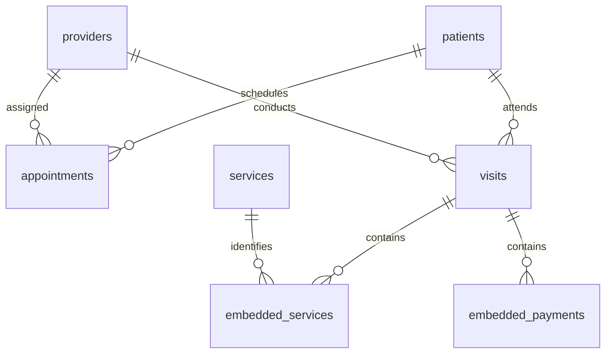

# MongoDB document model: MediCare Health Clinic

MIT 8103 · Osisiogu Nnabugwu · 301930508

## Workload and continuity

Receptionists retrieve appointments by patient/date or provider/date. Clinicians read one encounter with its services, payments and flexible clinical notes. Finance officers aggregate completed payments. Administrators count appointments and delivered services. The model follows these access patterns rather than creating one collection for every SQL table.

The five fictional patients, three providers, five catalogue services, five appointments, five visits, six delivered-service lines and five payments reuse Portfolio 1. Numeric identifiers preserve traceability. This is a separate fixture, not an export of a running PostgreSQL database or Portfolio 2's generated data. Registration dates are fixed teaching values instead of SQL CURRENT_DATE. SQL timestamps without a zone are interpreted as UTC. Payment timestamps, previously defaults, are fixed to visit times. Optional notes, vitals and allergies are fictional additions and are not clinical advice.

## Relational-to-document mapping

| Portfolio 1 table | MongoDB representation | Reason |
|---|---|---|
| Patients | `patients` | Independent demographics, no unbounded history array |
| Providers | `providers` | Shared provider identity |
| Appointments | `appointments` with patientId/providerId | Scheduling has an independent lifecycle and date queries |
| ClinicVisits | `visits` with patientId/providerId | Encounter is the aggregate boundary |
| MedicalServices | `services` | Current catalogue with unique service names |
| VisitServices | `visits.services[]` | Bounded delivered-service lines read with their visit |
| Payments | `visits.payments[]` | Bounded encounter payments read with their visit |

These are logical relationships. Embedded services and payments are arrays inside visits, not separate collections. MongoDB references do not establish foreign keys.

## Embedding, references and duplication

Each service line embeds serviceId, historical name, unitFeeKobo and quantity. Copying name and price preserves what was billed at the time: changing a catalogue price must not rewrite an old bill. Patient/provider names are read from current master records using `$lookup`; preserving historical identities would require an explicit snapshot policy.

Embedding permits an atomic update of a visit and its arrays in one document. Referencing avoids duplicated demographics and unbounded patient histories. Each visit array is capped at 100 items for this teaching workload, and MongoDB's 16 MiB document limit still applies. A clinic with long payment histories may need a separate immutable payment ledger and multi-document coordination. Appointment records remain independent from historical visits; the earlier schema did not require a visit-to-appointment link.

## Types and schema evolution

Fixtures use Extended JSON `$date`, parsed into BSON Date by EJSON.parse. Times use UTC. Money uses whole kobo (100 kobo = NGN 1), avoiding binary fractional currency. The small fixture values are exactly represented; larger systems need explicitly bounded safe integer values, BSON Long or Decimal128, with appropriate application arithmetic.

Strict JSON Schema validators require positive integral IDs and quantities, nonnegative service prices, positive payments, required names, BSON dates, enums and nested payment/service shapes. `_id` is unique automatically and service names have a unique index. `clinicalNotes` is deliberately a flexible optional object; `schemaVersion: 1` records the format. Additional extension fields are permitted. Future versions need version-aware readers and controlled migrations rather than assuming all historical documents change together.

## Integrity boundaries

Validators cannot enforce cross-collection reference existence. Tests audit patient/provider/service references and deliberately insert a syntactically valid orphan appointment, demonstrate acceptance, and remove it. Application code must check references and coordinate deletions. A simple check before inserting does not prevent a concurrent delete race.

Validators do not enforce total payments equalling charges, global paymentId uniqueness within embedded arrays, appointment non-overlap or valid clinical measurements. Production finance needs idempotency keys, immutable ledger entries, refunds and authorisation. The teaching fixture is not a production health-record system.

## Index design

| Index | Query supported | Cost or limit |
|---|---|---|
| appointments(patientId, appointmentDate) | Patient equality followed by date range | Write/storage overhead |
| appointments(providerId, appointmentDate) | Provider schedule by date | Does not prevent double bookings |
| visits(patientId, visitDate descending) | Recent patient history | Supports patient-specific retrieval |
| visits(services.serviceId) | Embedded service membership | Multikey index restrictions and extra keys |
| services(name) unique | Catalogue integrity/name lookup | Duplicate catalogue names rejected |

The explain test hints the compound patient/date index and verifies IXSCAN and the returned row. A five-appointment fixture cannot demonstrate a speed improvement. The multikey index does not remove the cost of unwinding all visits for a global report.

## Advanced-model alternatives

A document model supports variable clinical notes and encounter-local data. A graph model could support referral chains or patient-provider networks; there are no referral edges here and no graph database was implemented. A key-value cache could accelerate scheduling reads but would need invalidation. A wide-column model could suit large time-ordered observation streams with carefully chosen partitions. These are evaluated alternatives, not verified implementations.

For this clinic, PostgreSQL remains a strong choice for financial ledgers and strict relational integrity. MongoDB is a plausible alternative for flexible encounter records when its operational benefits justify application-managed relationships. This portfolio evaluates another model, not an automatic replacement of the SQL system.
