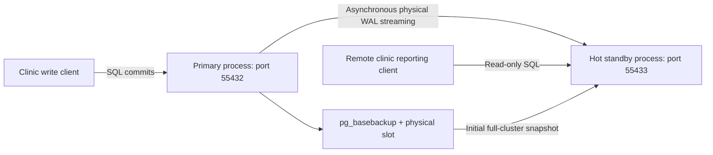

# Distributed database architecture

## Implemented topology



Both database servers are real PostgreSQL 16.11 processes with different data directories and TCP ports. They share one disposable Docker container, loopback networking and a single execution host. There are no host-published ports and the container uses `--network none`. This is a single-host emulation of geographically separated clinic databases, not an actual multi-site or multi-AZ deployment. The orchestrator is a Python standard-library client that invokes PostgreSQL utilities through Docker; it does not copy changed rows itself.

| Node | Initial role | Directory inside container | TCP port | Responsibility |
|---|---|---|---:|---|
| Central | Primary | `/tmp/primary` | 55432 | Patient, scheduling and finance writes |
| Remote clinic | Physical hot standby | `/tmp/standby` | 55433 | Replay WAL and serve read-only reports |
| Rejoined central | Fresh standby after promotion | `/tmp/rejoined` | 55432 | Follow the new primary; old directory stays stopped |

Only two PostgreSQL processes run simultaneously. Rejoined central is a replacement data directory on the former primary endpoint, not a third independent production site.

## Data continuity

Schema.sql and SampleData.sql are isolated copies of Portfolio 1's seven-table design and fictional dataset. They retain PKs, FKs, CHECK rules, identity keys and NUMERIC currency. Setup.sql adds ClinicBranches, ClinicAccounts and DistributionEvents; ClinicVisits gains a required BranchID foreign key. The three branches (Ikeja, Lekki, Abuja) are fictional extensions. Accounts reuse Portfolio 3's initial NGN 100,000 and NGN 50,000 balances. Portfolio 4's existing raw cloud and Codespaces logs were checked: both end with ALL TESTS PASSED and contain 25 PASS assertions. Its files remain unchanged.

Ten tables participate in consistency and restore checks. Database creation is confined to a new PostgreSQL cluster inside the temporary container; it never connects to the student's existing PostgreSQL service. The SQL fixture keeps Portfolio 1's CURRENT_DATE/CURRENT_TIMESTAMP defaults, so timestamp values and row hashes may vary on later runs. This is expected; equality is checked between endpoints within the same run.

Branch visits are distributed logically for reports (2, 2 and 1 visits), but every physical replica stores the complete cluster. BranchID is neither a shard key nor a security boundary. Ordinary table partitioning, manual row copying and independent branch writers are not implemented or presented as replication.

## Synchronisation protocol

The primary emits WAL with wal_level=replica. pg_basebackup creates the standby's consistent initial cluster snapshot. Its `-R` option writes standby.signal and connection configuration; `-X stream -C -S` establishes a physical slot and retains the required WAL. The standby's WAL receiver continues receiving changes after initial cloning. Inserts and updates made afterwards become visible through a separate standby connection, demonstrating continuing replication.

The mode is asynchronous: synchronous_commit=on flushes the primary's local WAL, while the absence of synchronous_standby_names means a commit does not wait for the remote standby. Replay-LSN barriers are test coordination, not a change to this commit guarantee. Replication slots protect short outages, but max_slot_wal_keep_size limits retained WAL; an overlong outage may invalidate the slot and require a new base backup. Monitor slot/WAL growth and do not treat wal_keep_size as a time-based recovery guarantee.

The implementation follows [PostgreSQL streaming-replication guidance](https://www.postgresql.org/docs/16/warm-standby.html) and [pg_basebackup semantics](https://www.postgresql.org/docs/16/app-pgbasebackup.html).

## Failure and rejoin sequence

```mermaid
sequenceDiagram
    participant C as Lab controller
    participant P as Initial primary 55432
    participant S as Standby 55433
    C->>S: Wait for replay LSN to reach primary target
    C->>P: Immediate stop; confirm pg_ctl status = stopped
    C->>S: Read existing patients successfully
    C->>S: Manual pg_ctl promote
    C->>S: Insert post-promotion event
    Note over P: Old directory stays fenced and is never restarted
    C->>S: pg_basebackup into new rejoined directory
    C->>P: Start fresh standby at 55432
    S->>P: Stream WAL on the new timeline
    C->>P: Verify post-promotion event and content digests
```

Failover is manual and orchestrated, with no failure detector, witness, election quorum, automatic routing, Patroni or managed HA controller. Stopping the old primary and not restarting its old directory prevents split brain within this lab. Production needs independent fencing and a coordinated failover mechanism; merely losing connectivity does not prove that a writer is dead. Rejoining uses a full new base backup, not pg_rewind. [PostgreSQL's failover documentation](https://www.postgresql.org/docs/16/warm-standby-failover.html) explains why the old primary cannot simply resume as a second writer.

## Consistency and clinic workflow

The writer owns authoritative updates; reporting clients may use the standby where stale data is acceptable. Read-after-write patient and billing decisions should remain on the writer or use an explicit replay-position/session consistency strategy. Offline branches cannot commit independently in this single-writer design. Queueing offline work would require conflict and idempotency policies and is outside the tested system.

A physical replica increases the number of locations holding all patient data. Production applications need individual accounts, restricted roles, branch-aware authorisation or RLS where appropriate, audit trails and data minimisation. The lab's administrative sessions do not implement those application controls.
