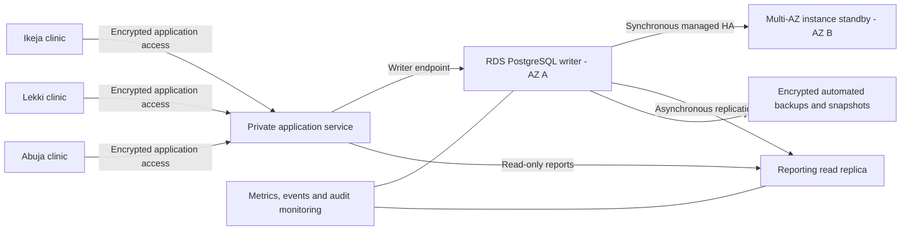

# Proposed cloud deployment architecture — not deployed

**Status:** Design only. No AWS resource, cloud database, endpoint, region allocation, billing subscription, deployment identifier or cloud performance result is claimed. No credentials were provided or requested. The executable assessment lab runs locally in Docker without a paid service.

## Proposed service and topology

Use managed Amazon RDS for PostgreSQL for the clinic's relational workload, with a private application tier. A proposed production configuration combines a Multi-AZ DB **instance** deployment for writer availability with a separate asynchronous read replica for reporting. The Multi-AZ instance standby is not a reporting endpoint; that is distinct from the different Multi-AZ DB cluster product. [AWS Multi-AZ overview](https://aws.amazon.com/rds/features/multi-az/)



The lab's asynchronous hot standby maps conceptually to a read replica, not to the proposed synchronous managed HA standby. Application connections must select the writer for freshness-sensitive actions. Read-replica lag can grow and promotion is a distinct operational action. Regional support, engine versions and permitted configurations must be checked before provisioning. [AWS read-replica documentation](https://docs.aws.amazon.com/AmazonRDS/latest/UserGuide/USER_ReadRepl.html)

## Compute, storage and scaling decisions

Start sizing from observed connection count, active workload, query plans, storage growth and I/O demand, not the five-patient fixture. Prefer an appropriate supported PostgreSQL release with current security patches; 16.11 is pinned here for reproducible laboratory execution, not asserted as the newest patch. Set storage headroom and growth alerts. Estimate WAL and replica bandwidth from measured write activity. Plan maintenance windows and application reconnect behaviour.

Vertical changes add writer compute/memory and may require maintenance. Read replicas offload suitable reads but do not distribute writes or remove the need for query optimisation. Add connection pooling before raising maximum connections. Larger multi-tenant or branch workloads might later justify partitioning, a different replication model or sharding, after measuring bottlenecks. Those are proposals, not tested scaling outcomes.

## Availability, backup and disaster recovery

Managed HA and read replication serve different purposes. Replication also propagates accidental changes, so it cannot replace backups. Enable encrypted automated backups with a retention period based on clinic policy and recovery requirements. Define business-approved RPO/RTO targets, then test them. Schedule restore drills into an isolated environment and verify row integrity plus application behaviour before declaring recovery. Do not infer a cloud recovery SLA from the local promotion timing. [AWS automated-backup and point-in-time recovery documentation](https://docs.aws.amazon.com/AmazonRDS/latest/UserGuide/USER_WorkingWithAutomatedBackups.html)

An optional cross-region replica or backup copy adds geographic resilience, transfer cost and legal implications; it is not included automatically. Keep recovery permissions and keys available independently of the failed environment, control snapshot sharing and document final-snapshot/deletion policy. The local pg_dump/pg_restore check demonstrates logical restore correctness only; cloud PITR and regional recovery were not executed.

## Network, encryption and access control

Keep the database private; only the application security group and approved administrative path should reach PostgreSQL. Clinic users access an authenticated application rather than connecting directly to a public database. Use least-privilege application/reporting roles, separate migration and administrative roles, MFA for administrators, secret rotation and audited emergency access. Do not copy the laboratory trust-based loopback PgHba.conf to cloud infrastructure.

Use TLS with certificate and hostname verification (`sslmode=verify-full`) and a current RDS CA trust bundle; test certificate rotation. [AWS PostgreSQL TLS instructions](https://docs.aws.amazon.com/AmazonRDS/latest/UserGuide/PostgreSQL.Concepts.General.SSL.html) Enable encryption at rest, including backups, and govern the KMS key lifecycle and permissions. [AWS encryption documentation](https://docs.aws.amazon.com/AmazonRDS/latest/UserGuide/Overview.Encryption.html)

Use secrets management or a protected local passfile instead of committing passwords, printing credential-bearing URIs or pasting them into screenshots. Retain audit evidence without recording unnecessary clinical content. Monitor permission changes as well as database activity.

## Monitoring and operations

Alert on replica lag, replication disconnections, CPU, memory, available storage, connection saturation, transaction/lock waits, backup failures, unusual access and failover events. Inspect slow-query statistics and application errors before scaling. Review replication-slot WAL retention on self-managed PostgreSQL; the managed service's replication and access controls are service-specific. Set escalation ownership, runbooks and periodic restore/failover drills. No cloud monitoring alarm has been created in this task.

## Cost considerations

The academic Docker lab needs no paid cloud subscription. For any optional RDS deployment, calculate compute hours for writer/HA/read replicas, storage and IOPS, backup retention, transfer, monitoring and key-management costs in the chosen region. Use [official RDS PostgreSQL pricing](https://aws.amazon.com/rds/postgresql/pricing/) and [AWS Pricing Calculator](https://calculator.aws/) when estimating; no fixed price or free-tier eligibility is asserted. Choose budget alerts, explicit teardown responsibility and retained-snapshot review before creating resources.

## Nigerian healthcare privacy

A production clinic must assess the Nigeria Data Protection Act 2023 and NDPC's final GAID 2025. Document a lawful basis and conditions for sensitive health information, minimise collection, restrict access, set retention, support data-subject rights and establish processor contracts. Perform the required privacy-impact and cross-border transfer assessments before using a foreign region or foreign support access. Region selection alone is not proof of compliance. [NDPC final GAID 2025](https://ndpc.gov.ng/wp-content/uploads/2025/07/NDP-ACT-GAID-2025-MARCH-20TH.pdf)

Assess applicable DPO/registration obligations and establish risk-based incident assessment and statutory breach-notification procedures with qualified Nigerian privacy/legal oversight. Cloud encryption does not itself establish legal compliance. Use the current regulator text and sector requirements for a real deployment; the portfolio's fictional data and controls do not constitute a legal compliance certification. The regulator PDF was found through indexed official excerpts; direct PDF retrieval returned HTTP 403 in this session. [NDPC](https://ndpc.gov.ng/)

## Optional future connection check — untested

CloudVerification.sql contains read-only connection, role/recovery and TLS checks. It has **not** been run against a managed cloud instance. After an owner provisions an approved private test database, installs the supported psql client, configures private connectivity and supplies credentials through a protected passfile or secret mechanism, set PGHOST, PGPORT, PGDATABASE, PGUSER and PGSSLROOTCERT outside Git. Then run from this portfolio directory:

```bash
PGSSLMODE=verify-full psql -X -v ON_ERROR_STOP=1 \
  -f Osisiogu_Nnabugwu_301930508_CloudVerification.sql
```

No command here provisions cloud resources or bypasses network policy. A successful connection/TLS check alone would not verify backups, failover, security compliance or multi-region performance. Record such results separately from the current local evidence if this optional step is later performed.
