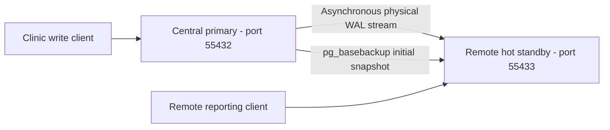

# Portfolio 5: Distributed and Cloud Databases

**Course:** MIT 8103 — Advanced Database Systems

**Assessment:** Individual Practical Database Portfolio

**Student:** Osisiogu Nnabugwu · **Student ID:** 301930508

**Case study:** MediCare Health Clinic (simulated)

**Implementation:** PostgreSQL 16.11 · physical streaming replication · Bash/Python · Docker

**Verified environments:** Managed Codex cloud execution host and the student's GitHub Codespace. Managed RDS deployment remains proposed and untested.

## 1. Introduction and background

Portfolios 1-3 have a relational clinic database, query optimisation and some PostgreSQL transaction experiments. Portfolio 4 is all MongoDB (both the cloud run and the student Codespaces) and then back to PostgreSQL to demonstrate replicated data between a central clinic and a remote clinic (simulated). Portfolios 1-4 are all the same.

The implementation is real PostgreSQL physical streaming replication between separate server processes on the same host. It's not table partitioning, it's not manual row copying, it's not a geographically separate deployment and it's not a production HA cluster.

## 2. Learning objectives

- Establish a primary and a hot standby using a physical base backup and WAL streaming.
- Observe inserts, updates and committed/rolled-back transactions through a separate replica connection.
- Check consistency, read-only enforcement, interruption recovery, manual promotion and rejoin.
- Measure replay catch-up behaviour without overstating performance results.
- Design a proposed cloud architecture covering security, privacy, cost, backups and operations.

No original lecturer rubric or mark allocation was found in the repository. The implementation follows the supplied Portfolio 5 task requirements.

## 3. Distributed clinic problem

Fictional Ikeja, Lekki and Abuja branches need consistent patient, scheduling, service and payment information. Independent writable copies could disagree about patient updates or payments. A central writer provides an authoritative update path, while a replica can serve reporting and support controlled recovery. Asynchronous replication introduces freshness and potential data-loss tradeoffs that an application must recognise.

## 4. Selected architecture and justification

PostgreSQL preserves the relational integrity rules from Portfolio 1 and the NUMERIC financial representation and transaction scenario used earlier. Physical streaming is a feasible demonstration of ongoing replication, including schema and row changes, without adding a distributed extension or a paid account. It copies the full database cluster, rather than selecting branch-specific rows. The new BranchID supports reports; it does not provide sharding or access control.

Two real server processes run in one disposable network-isolated container, with distinct data directories and ports. This avoids the local Docker VFS driver's large per-container image copies. It tests database-process failures but shares CPU, storage, container and host failure domains. [Architecture.md](Osisiogu_Nnabugwu_301930508_Architecture.md) explains the implementation and its limits.

## 5. Architecture diagram



The diagram shows the initial state. Once the old primary has been stopped and fenced, manual promotion makes port 55433 the new writer. A fresh base backup then creates a standby at port 55432 using a new data directory. The old primary directory is never brought back up as a competing writer. There's a full sequence diagram in the architecture document.

## 6. Files and implementation inventory

Every submitted file uses `Osisiogu_Nnabugwu_301930508_DocumentType.extension`. The existing root README provides repository navigation.

| Files (all have the required prefix) | Purpose |
|---|---|
| [Schema.sql](Osisiogu_Nnabugwu_301930508_Schema.sql), [SampleData.sql](Osisiogu_Nnabugwu_301930508_SampleData.sql) | Isolated copies of Portfolio 1's seven-table schema and fictional records |
| [Setup.sql](Osisiogu_Nnabugwu_301930508_Setup.sql) | Three fictional branches, two clinic accounts and distributed-event table |
| [Primary.conf](Osisiogu_Nnabugwu_301930508_Primary.conf), [PgHba.conf](Osisiogu_Nnabugwu_301930508_PgHba.conf) | Local-only PostgreSQL replication configuration |
| [ReplicatedChanges.sql](Osisiogu_Nnabugwu_301930508_ReplicatedChanges.sql), [Transaction.sql](Osisiogu_Nnabugwu_301930508_Transaction.sql), [Queries.sql](Osisiogu_Nnabugwu_301930508_Queries.sql) | Insert/update, financial transfer and read/report demonstrations |
| [Run.sh](Osisiogu_Nnabugwu_301930508_Run.sh), [Run.py](Osisiogu_Nnabugwu_301930508_Run.py) | Reproducible orchestration, assertions, measurements and cleanup |
| [Architecture.md](Osisiogu_Nnabugwu_301930508_Architecture.md) | Node responsibilities, data flow and failover/rejoin diagrams |
| [CloudDeployment.md](Osisiogu_Nnabugwu_301930508_CloudDeployment.md), [CloudVerification.sql](Osisiogu_Nnabugwu_301930508_CloudVerification.sql) | Proposed RDS design and optional untested read-only cloud connection/TLS checks |
| [Evaluation.md](Osisiogu_Nnabugwu_301930508_Evaluation.md), [Measurements.json](Osisiogu_Nnabugwu_301930508_Measurements.json) | Actual measurements, reliability results and interpretation |
| [ExecutionOutput.txt](Osisiogu_Nnabugwu_301930508_ExecutionOutput.txt), [EvidenceManifest.json](Osisiogu_Nnabugwu_301930508_EvidenceManifest.json) | Actual recorded output, exit status, version/digest and provenance hashes |
| [CaptureEvidence.py](Osisiogu_Nnabugwu_301930508_CaptureEvidence.py) | Optional genuine browser captures of recorded output |
| [Validate.py](Osisiogu_Nnabugwu_301930508_Validate.py) | Reproducible file/link/hash/preservation checks |
| [References.md](Osisiogu_Nnabugwu_301930508_References.md), [AIUseDeclaration.md](Osisiogu_Nnabugwu_301930508_AIUseDeclaration.md) | Official sources and disclosure |
| [CodespacesExecution.txt](Osisiogu_Nnabugwu_301930508_CodespacesExecution.txt), [CodespacesTests.png](screenshots/Osisiogu_Nnabugwu_301930508_CodespacesTests.png) | Student Codespaces execution log and genuine terminal screenshot |
| This README and five prefixed PNGs in `screenshots/` | Portfolio entry point and execution evidence |

## 7. Database setup

The runner creates a uniquely named temp container, sets up a PostgreSQL cluster as the unprivileged postgres OS user, applies Primary.conf and the loopback only PgHba.conf, starts the writer on port 55432 and creates medicare_portfolio5. It then runs Schema.sql, SampleData.sql and Setup.sql, and uses pg_basebackup with a physical replication slot to create a hot standby on port 55433. The PostgreSQL utilities are provided by the pinned Docker image.

The fictional data comprises 5 patients, 3 providers, 5 appointments, 5 clinic visits, 5 catalogue services, 6 delivered service rows, and 5 payments. Portfolio 5 adds 3 branches, 2 accounts, and an initially empty event table. The dates generated via the SQL defaults are date/time values which are date/time values relative to the run date (i.e. they are not fixed).tency is checked in each run. All of the changes affectable clusters and in no way impact the student's existing PostgreSQL or MongoDB databases.

## 8. Practical experiments

1. Connect to both servers, verify the primary/standby status, check the async WAL streaming and the physical slot and compare all ten tables.

2. Insert a branch event and update a fictional patient's phone on the writer. Wait for the target WAL LSN to replay and then read both changes from the standby.

3. Commit an NGN 10,000 account transfer, check the replica balances of NGN 90,000 and NGN 60,000. Roll back that transfer and confirm the visible balances are still the same.

4. Try a standby insert and confirm that the expected read only SQLSTATE 25006 rejection occurs.

5. Turn off the standby, trigger another event on the async writer, restart the replica and check that catch-up and content are in fact equal.
6. Wait for the replay, immediately stop the primary, confirm it's fenced, read from the standby and manually promote it. Verify a post promotion write.

7. Create a new base backup from the new primary into a fresh directory and start it as a standby on the old endpoint. Check the event and all-table consistency of the new timeline.

8. Create a logical pg_dump archive, restore it into a separate database and compare all ten restored tables plus the account total.

Each replay wait has a 30 second deadline; command failures and command mismatches will exit non-zero. The runner will only remove its own uniquely named container and its own anonymous image volume on exit. The database files, any transient backups and logs within it are all discarded. Stdout is the only persistent assessment evidence. This is an experiment runner not a long running hosted database.

## 9. Actual results

The original managed-cloud PostgreSQL run returned **exit code 0**, **37 PASS assertions** and `ALL PORTFOLIO 5 TESTS PASSED`. It used PostgreSQL 16.11 and the image digest recorded in EvidenceManifest.json. Completed revenue was NGN 22,000: Ikeja NGN 9,000, Lekki NGN 6,000 and Abuja NGN 7,000. Branch visits were 2, 2 and 1. All ten table content hashes matched at each quiescent comparison; all ten also matched after restore.

Client-observed catch-up waits in the original managed-cloud run ranged from 77.380 to 104.023 ms. The measured stop/check/manual-promotion sequence took 516.259 ms. These values include command/polling overhead, are one run on loopback, and are not pure replication latency, a throughput benchmark or a cloud recovery SLA. [Evaluation.md](Osisiogu_Nnabugwu_301930508_Evaluation.md) and Measurements.json contain the exact observations and limits.

The logged SQLSTATE 25006 error is expected evidence that the standby rejects writes; it is followed by a passing assertion. No unsuccessful PostgreSQL assertion is hidden in the submitted successful log.

The student subsequently reproduced the lab in GitHub Codespaces. The [Codespaces execution log](Osisiogu_Nnabugwu_301930508_CodespacesExecution.txt) contains **37 PASS assertions** and ends with `ALL PORTFOLIO 5 TESTS PASSED`; the [terminal screenshot](screenshots/Osisiogu_Nnabugwu_301930508_CodespacesTests.png) shows the final results. That separate run recorded catch-up waits from 94.173 to 136.222 ms and a stop/check/manual-promotion sequence of 897.280 ms, including client and polling overhead. These are separate observations, not replacements for the original Measurements.json or evidence manifest. Codespaces execution does not establish a managed RDS deployment or multi-host fault tolerance.

## 10. Consistency, availability and fault tolerance

The primary flushes the local WAL prior to acknowledging a normal commit and doesn't wait for standby ack. Central writes therefore carry on during a replica outage (at the expense of potentially stale remote data and loss of unreplicated transactions if the writer fails). The test does its controlled writer failure after catch-up so it doesn't establish zero RPO asynchronous failover.

Standby reads are available when the primary is stopped, writes however require promotion and routing to the new primary. Failover is manual (no automatic election, no quorum protocol). Fencing is important in that a disconnected writer must not be allowed to rejoin with another primary. A new base backup rejoining will follow the new timeline. The lab doesn't simulate WAN partitions, independent host failures or multi-writer conflicts.

## 11. Proposed cloud deployment

[CloudDeployment.md](Osisiogu_Nnabugwu_301930508_CloudDeployment.md) proposes private Amazon RDS for PostgreSQL with a managed Multi-AZ DB instance standby for writer availability, a separate asynchronous reporting replica, encrypted backups and monitored application access. The managed HA standby and reporting replica have different responsibilities. This is a proposed architecture, not a completed deployment, and no paid subscription is needed to reproduce the lab.

CloudVerification.sql is an optional future read-only connection/TLS check. It was not run against a cloud database. No cloud identifiers, deployment screenshots or pricing results are invented.

## 12. Security, privacy and backup considerations

The isolated lab allows for trusted loopback admin/replication connections and has PostgreSQL bound to 127.0.0.1 within the container with no network or host published ports. These are very deliberately local settings and should not in any way be used as a cloud security example. A cloud design would require verified TLS, credentials that are protected, private connectivity, least privilege, audited access and encryption at rest.

The cloud document covers Nigerian NDPA/GAID obligations, sensitive health information, lawful processing, privacy impact assessment, and cross-border review. No actual clinical data is used. Replication is not a backup as it will also propagate the errors. The local dump/restore is the real one. Continuous WAL archiving, cloud PITR and regional DR are all untested.

## 13. Challenges encountered

We started a multi-container MongoDB exploration prior to the detailed preference for PostgreSQL. That one hit the Docker VFS disk limit on the execution host and was put on hold. The PostgreSQL we've assessed uses a single image/container with two database processes to keep the resource consumption in check. The MongoDB exploration is not part of this submission.

No lecturer rubric, no cloud account binding and no managed database credentials were available. The task therefore defines the implementation scope from the requirements as supplied and labels the cloud steps as proposed. The official indexed NDPC final-GAID extracts were available, direct PDF fetches returned HTTP 403 and the documentation states it's an access limit rather than a full legal review.

## 14. Lessons and technical reflection

The experiments prove why an acknowledged async commit and a fresh replica read are two very different things. The replay position checks make the tests deterministic without altering the production commit semantics in any way. A replica provides read capacity and a recovery path but by itself does not create a service that is outage free or geographically resilient. Stopping the old writer is part of the safe promotion process and rejoining requires you to follow the new timeline.

The 'lessons' reported are derived from the technical work carried out with AI assistance; they do not constitute the student's own personal experience. The student would be expected to add their own interpretation following the reproduction of the exercises if the assessment is asking for a personal reflective account.

## 15. Reproduction instructions

Requirements: Bash, Python 3.9+ (standard library only), Docker CLI and a running local Docker daemon accessible to the user (with sufficient memory and disk to accommodate the pinned PostgreSQL image and two small clusters). This run used a Docker VFS host with 7.9GiB total filesystem capacity and after cleanup retained over 2GiB free at runtime. Requirements are dependent on the storage driver and existing images and this is not a universal minimum.

From the repository root in an existing Codespace or Linux workstation:

```bash
cd Osisiogu_Nnabugwu_301930508/portfolio-5-distributed-cloud
set -o pipefail
bash Osisiogu_Nnabugwu_301930508_Run.sh 2>&1 \
  | tee Osisiogu_Nnabugwu_301930508_CodespacesExecution.txt
```

The first run will pull postgres:16.11-bookworm if it's not already there. Docker is explicitly directed at the local Unix socket so the inherited remote-daemon settings won't have any effect on another machine. It requires no sudo, no local PostgreSQL install, no cloud account and no Python DB driver. The existing PostgreSQL service for the older portfolios is left completely untouched. On success the runner will end with ALL PORTFOLIO 5 TESTS PASSED.

The student has now successfully run this command in Codespaces and saved the prefixed execution log and terminal screenshot linked below. Future reruns can use the same command; the Codespaces evidence remains separate from the original managed-cloud run.
Run static QA from this directory with:

```bash
python3 Osisiogu_Nnabugwu_301930508_Validate.py
```

Optional screenshot regeneration requires Python Playwright and installed Chromium, default /usr/bin/chromium or CHROMIUM_PATH, then CaptureEvidence.py. It reads the actual submitted ExecutionOutput.txt and does not execute the database or create synthetic query results.

## 16. Screenshots and supporting evidence

- [Setup and streaming](screenshots/Osisiogu_Nnabugwu_301930508_SetupAndStreaming.png)
- [Replicated changes and replica recovery](screenshots/Osisiogu_Nnabugwu_301930508_ReplicatedChanges.png)
- [Promotion and rejoin](screenshots/Osisiogu_Nnabugwu_301930508_PromotionAndRejoin.png)
- [Restore and final verdict](screenshots/Osisiogu_Nnabugwu_301930508_RestoreAndVerdict.png)

These four images are genuine Chromium screenshots of a plain, explicitly labelled browser log viewer displaying unaltered sections of the original managed-cloud PostgreSQL stdout. They are not terminal screenshots or Codespaces evidence. Each shows the source SHA-256, and their hashes are in EvidenceManifest.json. The full original raw log is the authoritative record for that run.

Additional student Codespaces evidence:

- [Successful Codespaces execution log](Osisiogu_Nnabugwu_301930508_CodespacesExecution.txt)
- [Genuine Codespaces terminal screenshot](screenshots/Osisiogu_Nnabugwu_301930508_CodespacesTests.png)

The Codespaces screenshot is a separate terminal capture showing the restore checks and final success verdict; it is not one of the four browser log-viewer images. No generated illustration is presented as execution evidence.

## 17. Conclusion

The portfolio implements and validates physical PostgreSQL replication, consistency checks, read-only enforcement, short outage recovery, controlled manual promotion, safe rejoin and logical restore using the MediCare data set. It then ties that all together to a clearly delineated proposed managed cloud design and identifies what the single host experiment simply cannot prove.

## 18. References and verification

[References.md](Osisiogu_Nnabugwu_301930508_References.md) lists official PostgreSQL, AWS and NDPC sources. [Validate.py](Osisiogu_Nnabugwu_301930508_Validate.py) checks file integrity, relative links and preservation of the earlier portfolios. Marks cannot be allocated without the lecturer's actual rubric.

## 19. AI assistance declaration

AI assistance was used for implementation, verification, documentation, source research and GitHub preparation. [AIUseDeclaration.md](Osisiogu_Nnabugwu_301930508_AIUseDeclaration.md) identifies the assistance and the student's remaining responsibility to understand/reproduce the work and follow institutional policy.
