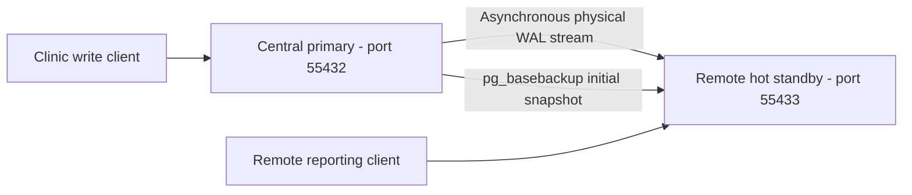

# Portfolio 5: Distributed and Cloud Databases

**Course:** MIT 8103 — Advanced Database Systems

**Assessment:** Individual Practical Database Portfolio

**Student:** Osisiogu Nnabugwu · **Student ID:** 301930508

**Case study:** MediCare Health Clinic (simulated)

**Implementation:** PostgreSQL 16.11 · physical streaming replication · Bash/Python · Docker

**Verified environment:** Managed Codex cloud execution host, not the student's Codespace or managed RDS

## 1. Introduction and background

Portfolios 1–3 developed a relational clinic database, query optimisation and PostgreSQL transaction experiments. Portfolio 4 explored MongoDB and includes both cloud-run and student Codespaces evidence. This portfolio returns to PostgreSQL to demonstrate replicated information across a central clinic and a simulated remote clinic. Portfolios 1–4 remain unchanged.

The implementation is genuine PostgreSQL physical streaming replication between separate server processes on one host. It is not table partitioning, manual row copying, an actual geographically separated deployment or a production HA cluster.

## 2. Learning objectives

- Establish a primary and a hot standby using a physical base backup and WAL streaming.
- Observe inserts, updates and committed/rolled-back transactions through a separate replica connection.
- Check consistency, read-only enforcement, interruption recovery, manual promotion and rejoin.
- Measure replay catch-up behaviour without overstating performance results.
- Design a proposed cloud architecture covering security, privacy, cost, backups and operations.

No original lecturer rubric or mark allocation was found in the repository. The implementation follows the supplied Portfolio 5 task requirements.

## 3. Distributed clinic problem

Fictional Ikeja, Lekki and Abuja branches need consistent patient, scheduling, service and payment information. Independent writable copies could disagree about patient updates or payments. A central writer provides an authoritative update path, while a replica can serve reporting and support controlled recovery. Asynchronous replication introduces freshness and potential data-loss tradeoffs that an application must recognise.

## 4. Selected architecture and justification

PostgreSQL preserves the relational integrity rules from Portfolio 1 and the NUMERIC financial representation and transaction scenario used earlier. Physical streaming is a feasible demonstration of ongoing replication, including schema and row changes, without adding a distributed extension or a paid account. It copies the full database cluster, rather than selecting branch-specific rows. The new BranchID supports reports; it does not provide sharding or access control.

Two real server processes run in one disposable network-isolated container, with distinct data directories and ports. This avoids the local Docker VFS driver's large per-container image copies. It tests database-process failures but shares CPU, storage, container and host failure domains. [Architecture.md](Osisiogu_Nnabugwu_301930508_Architecture.md) explains the implementation and its limits.

## 5. Architecture diagram



The diagram shows the initial state. After the old primary is stopped and fenced, manual promotion makes port 55433 the new writer. A fresh base backup creates a standby at port 55432 using a new data directory. The old primary directory is never restarted as a competing writer. The architecture document includes a detailed sequence diagram.

## 6. Files and implementation inventory

Every submitted file uses `Osisiogu_Nnabugwu_301930508_DocumentType.extension`. The existing root README provides repository navigation.

| Files (all have the required prefix) | Purpose |
|---|---|
| [Schema.sql](Osisiogu_Nnabugwu_301930508_Schema.sql), [SampleData.sql](Osisiogu_Nnabugwu_301930508_SampleData.sql) | Isolated copies of Portfolio 1's seven-table schema and fictional records |
| [Setup.sql](Osisiogu_Nnabugwu_301930508_Setup.sql) | Three fictional branches, two clinic accounts and distributed-event table |
| [Primary.conf](Osisiogu_Nnabugwu_301930508_Primary.conf), [PgHba.conf](Osisiogu_Nnabugwu_301930508_PgHba.conf) | Local-only PostgreSQL replication configuration |
| [ReplicatedChanges.sql](Osisiogu_Nnabugwu_301930508_ReplicatedChanges.sql), [Transaction.sql](Osisiogu_Nnabugwu_301930508_Transaction.sql), [Queries.sql](Osisiogu_Nnabugwu_301930508_Queries.sql) | Insert/update, financial transfer and read/report demonstrations |
| [Run.sh](Osisiogu_Nnabugwu_301930508_Run.sh), [Run.py](Osisiogu_Nnabugwu_301930508_Run.py) | Reproducible orchestration, assertions, measurements and cleanup |
| [Architecture.md](Osisiogu_Nnabugwu_301930508_Architecture.md) | Node responsibilities, data flow and failover/rejoin diagrams |
| [CloudDeployment.md](Osisiogu_Nnabugwu_301930508_CloudDeployment.md), [CloudVerification.sql](Osisiogu_Nnabugwu_301930508_CloudVerification.sql) | Proposed RDS design and optional untested read-only cloud connection/TLS checks |
| [Evaluation.md](Osisiogu_Nnabugwu_301930508_Evaluation.md), [Measurements.json](Osisiogu_Nnabugwu_301930508_Measurements.json) | Actual measurements, reliability results and interpretation |
| [ExecutionOutput.txt](Osisiogu_Nnabugwu_301930508_ExecutionOutput.txt), [EvidenceManifest.json](Osisiogu_Nnabugwu_301930508_EvidenceManifest.json) | Actual recorded output, exit status, version/digest and provenance hashes |
| [CaptureEvidence.py](Osisiogu_Nnabugwu_301930508_CaptureEvidence.py) | Optional genuine browser captures of recorded output |
| [Verification.md](Osisiogu_Nnabugwu_301930508_Verification.md), [Validate.py](Osisiogu_Nnabugwu_301930508_Validate.py) | QA record and reproducible file/link/hash/preservation checks |
| [References.md](Osisiogu_Nnabugwu_301930508_References.md), [AIUseDeclaration.md](Osisiogu_Nnabugwu_301930508_AIUseDeclaration.md) | Official sources and disclosure |
| This README and four prefixed PNGs in `screenshots/` | Portfolio entry point and execution evidence |

## 7. Database setup

The runner creates a uniquely named temporary container, initialises a PostgreSQL cluster as the unprivileged postgres OS user, applies Primary.conf and the loopback-only PgHba.conf, starts the writer at port 55432 and creates medicare_portfolio5. It executes Schema.sql, SampleData.sql and Setup.sql, then uses pg_basebackup with a physical replication slot to create a hot standby at port 55433. PostgreSQL utilities are supplied by the pinned Docker image.

The fictional data includes 5 patients, 3 providers, 5 appointments, 5 clinic visits, 5 catalogue services, 6 delivered-service rows and 5 payments. Portfolio 5 adds 3 branches, 2 accounts and an initially empty event table. Dates generated by the SQL defaults depend on the run date; consistency is assessed within each run. All changes are inside disposable clusters and do not touch the student's existing PostgreSQL or MongoDB databases.

## 8. Practical experiments

1. Connect to both servers, confirm their primary/standby roles, inspect async WAL streaming and the physical slot, and compare all ten tables.
2. Insert a branch event and update a fictional patient's phone on the writer. Wait for the target WAL LSN to replay and read both changes from the standby.
3. Commit a NGN 10,000 account transfer; verify replica balances of NGN 90,000 and NGN 60,000. Roll back another transfer and confirm the visible balances remain unchanged.
4. Attempt a standby insert and verify the expected read-only SQLSTATE 25006 rejection.
5. Stop the standby, commit another event on the asynchronous writer, restart the replica and verify catch-up and content equality.
6. Wait for replay, immediately stop the primary, confirm it is fenced, read from the standby and manually promote it. Verify a post-promotion write.
7. Create a new base backup from the new primary into a fresh directory and start it as a standby on the old endpoint. Verify the new timeline's event and all-table consistency.
8. Create a logical pg_dump archive, restore it into a separate database and compare all ten restored tables plus the account total.

Each replay wait has a 30-second deadline; command failures or mismatches exit nonzero. The runner removes only its own uniquely named container and its anonymous image volume on exit. Database files, transient backups and logs inside it are discarded; stdout is the persistent assessment evidence. This is an experiment runner, not a long-running hosted database.

## 9. Actual results

The recorded PostgreSQL run returned **exit code 0**, **37 PASS assertions** and `ALL PORTFOLIO 5 TESTS PASSED`. It used PostgreSQL 16.11 and the image digest recorded in EvidenceManifest.json. Completed revenue was NGN 22,000: Ikeja NGN 9,000, Lekki NGN 6,000 and Abuja NGN 7,000. Branch visits were 2, 2 and 1. All ten table content hashes matched at each quiescent comparison; all ten also matched after restore.

Client-observed catch-up waits in this run ranged from 77.380 to 104.023 ms. The measured stop/check/manual-promotion sequence took 516.259 ms. These values include command/polling overhead, are one run on loopback, and are not pure replication latency, a throughput benchmark or a cloud recovery SLA. [Evaluation.md](Osisiogu_Nnabugwu_301930508_Evaluation.md) and Measurements.json contain the exact observations and limits.

The logged SQLSTATE 25006 error is expected evidence that the standby rejects writes; it is followed by a passing assertion. No unsuccessful PostgreSQL assertion is hidden in the submitted successful log.

## 10. Consistency, availability and fault tolerance

The primary flushes local WAL before acknowledging a normal commit but does not wait for standby acknowledgement. Central writes therefore continue during a replica interruption, at the cost of possible stale remote data and loss of unreplicated transactions if the writer fails. The test waits for catch-up before its controlled writer failure, so it does not establish zero-RPO asynchronous failover.

Standby reads remain available when the primary is stopped, but writes require promotion and routing to the new primary. Failover here is manual, not an automatic election or a quorum protocol. Fencing matters: a disconnected writer must not be allowed to resume alongside another primary. Rejoining by a new base backup follows the new timeline. The lab does not simulate WAN partitions, independent host failures or multi-writer conflicts.

## 11. Proposed cloud deployment

[CloudDeployment.md](Osisiogu_Nnabugwu_301930508_CloudDeployment.md) proposes private Amazon RDS for PostgreSQL with a managed Multi-AZ DB instance standby for writer availability, a separate asynchronous reporting replica, encrypted backups and monitored application access. The managed HA standby and reporting replica have different responsibilities. This is a proposed architecture, not a completed deployment, and no paid subscription is needed to reproduce the lab.

CloudVerification.sql is an optional future read-only connection/TLS check. It was not run against a cloud database. No cloud identifiers, deployment screenshots or pricing results are invented.

## 12. Security, privacy and backup considerations

The isolated lab permits trusted loopback administrative/replication connections and binds PostgreSQL to 127.0.0.1 inside a container with no network or host-published ports. These settings are deliberately local and must not be used as a cloud security template. Cloud design requires verified TLS, protected credentials, private connectivity, least privilege, audited access and encryption at rest.

The cloud document discusses Nigerian NDPA/GAID obligations, sensitive healthcare information, lawful processing, privacy-impact assessment and cross-border review. No real clinical information is used. Replication is not a backup because it also propagates mistakes. The local dump/restore check is genuine; continuous WAL archiving, cloud PITR and regional disaster recovery are untested proposals.

## 13. Challenges encountered

A multi-container MongoDB exploration was started before the detailed preference for PostgreSQL arrived. It hit the execution host's Docker VFS disk limit and was set aside. The assessed PostgreSQL implementation uses one image/container and two database processes to keep resource needs manageable. The MongoDB exploration is not part of this submission.

No lecturer rubric, cloud account binding or managed database credentials were available. The task therefore uses the supplied requirements to define the implementation scope and labels cloud steps as proposed. Official indexed NDPC final-GAID excerpts were available, while direct PDF fetching returned HTTP 403; the documentation reports that access limit rather than claiming a full legal review.

## 14. Lessons and technical reflection

The experiments demonstrate why an acknowledged asynchronous commit and a fresh replica read are different guarantees. Replay-position checks make the tests deterministic without changing production commit semantics. A replica offers read capacity and a recovery path but does not make an outage-free or geographically resilient service by itself. Stopping a former writer is part of safe promotion, and rejoining requires following the new timeline.

The reported lessons arise from the technical work performed with AI assistance; they do not invent the student's personal experience. The student should add their own interpretation after reproducing the exercises if the assessment asks for a personal reflective account.

## 15. Reproduction instructions

Requirements: Bash, Python 3.9+ (standard library only), Docker CLI and a running local Docker daemon accessible to the user, with enough memory/disk for the pinned PostgreSQL image and two small clusters. This run used a Docker VFS host with 7.9 GiB total filesystem capacity; at runtime it retained more than 2 GiB free after cleanup. Requirements depend on storage driver and existing images; this is not a universal minimum specification.

From the repository root in an existing Codespace or Linux workstation:

```bash
cd Osisiogu_Nnabugwu_301930508/portfolio-5-distributed-cloud
set -o pipefail
bash Osisiogu_Nnabugwu_301930508_Run.sh 2>&1 \
  | tee Osisiogu_Nnabugwu_301930508_CodespacesExecution.txt
```

The first run pulls postgres:16.11-bookworm if absent. Docker is explicitly directed to the local Unix socket so inherited remote-daemon settings cannot affect another machine. It requires no sudo, host PostgreSQL installation, cloud account or Python database driver. The existing PostgreSQL service for earlier portfolios is unaffected. The runner ends with ALL PORTFOLIO 5 TESTS PASSED on success.

The student's Codespaces run of Portfolio 5 remains unverified until they execute this command. Save that new log and any actual terminal screenshots under the same prefix; keep them distinct from the submitted cloud-host run.

Run static QA from this directory with:

```bash
python3 Osisiogu_Nnabugwu_301930508_Validate.py
```

Optional screenshot regeneration requires Python Playwright and installed Chromium, default /usr/bin/chromium or CHROMIUM_PATH, then CaptureEvidence.py. It reads the actual submitted ExecutionOutput.txt and does not execute the database or create synthetic query results.

## 16. Screenshots and supporting evidence

- [Setup and streaming](screenshots/Osisiogu_Nnabugwu_301930508_SetupAndStreaming.png)
- [Replicated changes and replica recovery](screenshots/Osisiogu_Nnabugwu_301930508_ReplicatedChanges.png)
- [Promotion and rejoin](screenshots/Osisiogu_Nnabugwu_301930508_PromotionAndRejoin.png)
- [Restore and final verdict](screenshots/Osisiogu_Nnabugwu_301930508_RestoreAndVerdict.png)

These are genuine Chromium screenshots of a plain, explicitly labelled browser log viewer showing unmodified sections of actual recorded PostgreSQL stdout. They do not imitate a terminal or represent direct Codespaces execution. Each displays the source SHA-256; screenshot/source hashes are in EvidenceManifest.json. The complete raw log is authoritative. No generated illustration is presented as execution evidence.

## 17. Conclusion

The portfolio implements and verifies physical PostgreSQL replication, consistency checks, read-only enforcement, short-outage recovery, controlled manual promotion, safe rejoin and logical restore using the MediCare dataset. It connects those results to a clearly separated proposed managed-cloud design while identifying what the single-host experiment cannot establish.

## 18. References and verification

[References.md](Osisiogu_Nnabugwu_301930508_References.md) lists official PostgreSQL, AWS and NDPC sources. [Verification.md](Osisiogu_Nnabugwu_301930508_Verification.md) records QA and preservation. Marks cannot be allocated without the lecturer's actual rubric.

## 19. AI assistance declaration

AI assistance was used for implementation, verification, documentation, source research and GitHub preparation. [AIUseDeclaration.md](Osisiogu_Nnabugwu_301930508_AIUseDeclaration.md) identifies the assistance and the student's remaining responsibility to understand/reproduce the work and follow institutional policy.
